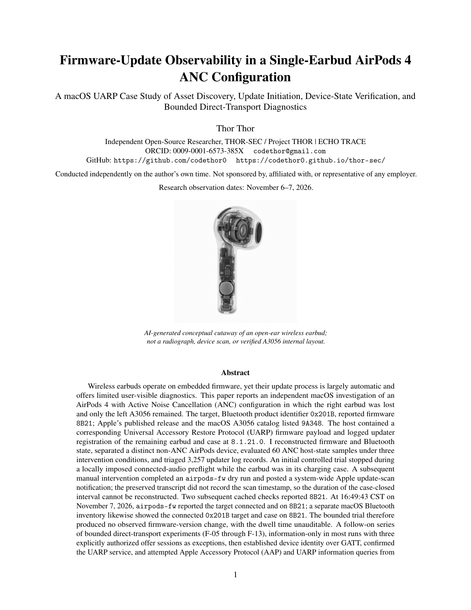
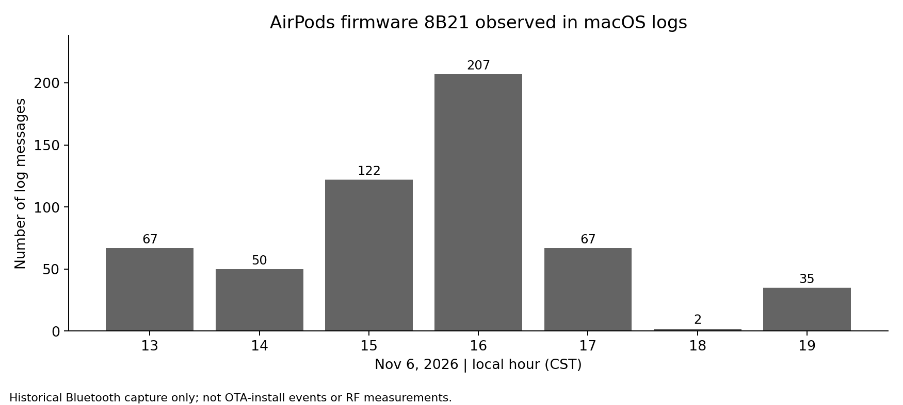
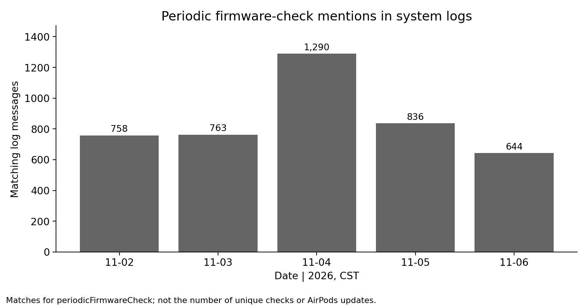
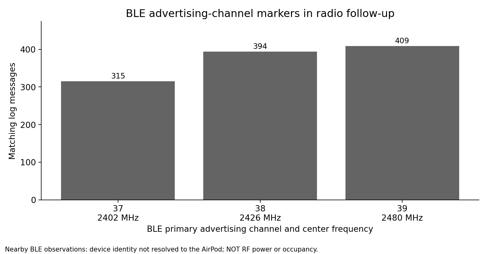

[Published paper (DOI)](https://doi.org/10.5281/zenodo.24056722) | [Read the PDF](paper/ECHO_TRACE_A3056_Research_Paper.pdf)

# Project THOR | ECHO TRACE

**AirPods 4 ANC (A3056) single-earbud firmware-update observability study.** Independent research preprint, published November 8, 2026. Version 1.0.

[Read and cite the published paper](https://doi.org/10.5281/zenodo.24056722) | [Zenodo research record](https://zenodo.org/records/24056722)

## Question

A surviving left AirPods 4 ANC earbud (A3056, Bluetooth product ID `0x201B`) continued reporting firmware `8B21`. Apple published `9A348` for the model family, and macOS had a matching UARP asset cached. The right earbud was missing. What could be verified about the update path?

## Verified observations

| Stage | Evidence |
| --- | --- |
| Release and local asset | Firmware `9A348` published for the family and matching UARP asset cached on macOS |
| Host-side scan | A bounded scan request was posted; connected verification still showed `8B21` |
| Accessory identification | GATT identity and UARP service confirmed in bounded diagnostic trials |
| Direct firmware offers | Three authorized asset-available offers were acknowledged |
| Image transfer | No firmware-image request was observed; no firmware-image bytes were served |
| Activation | No staging or Apply command was sent; an installed update was not established |
| ANC observations | 60 host-state observations across three conditions |

**The cause remains unresolved.** The missing companion earbud is a testable hypothesis, not a demonstrated requirement for this exact hardware. Client-decoded terminal notifications have status ambiguities, and prior-session state was not eliminated as a possible explanation.

## Figures

The paper's cover cutaway is AI-generated conceptual artwork, not a scan or measured depiction of A3056 internals.

## Research material

- [`paper/`](paper/): the exact published PDF and its LaTeX source
- [`figures/`](figures/): four public illustrations from the research package
- [`supplement/`](supplement/): sanitized transport trials, UARP observations and ANC host-state datasets
- [`SHA256SUMS.txt`](SHA256SUMS.txt): checksums for the public repository artifacts
- [`CITATION.cff`](CITATION.cff): machine-readable Zenodo citation

The complete deposited archive, including the separately MIT-licensed public reproducibility scripts, is available on [Zenodo](https://doi.org/10.5281/zenodo.24056722). **No scripts or operational tools are mirrored in this repository.**

## Scope and limitations

- Asset availability, scan initiation, transfer, staging, and activation are distinct states.
- An acknowledged offer does not prove firmware was transferred or installed.
- Status `0x0003` in F-08U/V has more than one published interpretation for related hardware.
- The cached firmware signature was not independently cryptographically verified.
- ANC host-state telemetry is not acoustic or RF exposure measurement.
- No raw logs, serial numbers, Bluetooth addresses, private pairing identifiers, or Apple firmware assets are included.

## Citation and licensing

**Thor, T. (2026).** *Firmware-Update Observability in a Single-Earbud AirPods 4 ANC Configuration: A macOS UARP Case Study of Asset Discovery, Update Initiation, Device-State Verification, and Bounded Direct-Transport Diagnostics* (Version 1.0). Zenodo. https://doi.org/10.5281/zenodo.24056722

Research documents, PDF, LaTeX, figures and sanitized datasets in this repository are [CC BY 4.0](https://creativecommons.org/licenses/by/4.0/). The two public scripts distributed **only in the Zenodo archive** are under MIT; see `scripts/LICENSE` inside that archive. See [license scope](LICENSE_SCOPE.md).

Independent study. Not affiliated with or endorsed by Apple.
